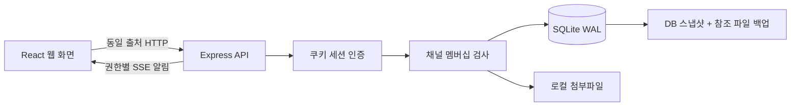

# 첫 버전 설계

기준: 2026-10-19 Slack 공개 기능 분석. 이번 범위는 연구실에서 바로 시험할 수 있는 채팅 코어입니다. Slack 서버 구현을 알아냈다는 주장이나 유료 워크스페이스 동작 복제 검증은 포함하지 않습니다.

## 데이터 흐름

메시지 본문을 SSE에 중복 전송하지 않습니다. 허용된 채널의 변경 알림을 받은 화면이 권한 검사를 거치는 API에서 기록을 다시 읽습니다. 세션 만료·로그아웃 시 스트림을 끊고 재접속 때 다시 인증합니다. 재연결과 화면 복귀 때도 기록을 다시 읽습니다.

## 책임과 식별자

| 모델 | 역할 |
|---|---|
| users / sessions / invites | 내부 사용자 UUID, 외부 계정 연결점, 비밀번호 해시, 세션·초대 해시 |
| channels / memberships | 공개·비공개·DM, 접근 권한, 사용자별 읽음 위치 |
| messages / mentions | 순증가 메시지 ID, 원문과 답글, 수정·삭제 상태, 명시적 @handle 멘션 |
| files / reactions | 서버 생성 저장 파일명, 다운로드 권한의 근거가 되는 메시지, 사용자별 반응 |
| audit_log / app_meta | 관리 동작 기록, 실제 계정·체험 데이터 모드 분리 |

채널 권한은 서버의 `membership` 조회가 소유합니다. UI에서 숨기기만 하지 않고 조회·검색·파일·스트림 등 모든 소비 경로에서 검사합니다. 관리자 권한은 초대와 관리 화면, 자신이 참여한 채널의 메시지 삭제에 사용합니다.

클라이언트 본문은 React 텍스트로 표시하며 HTML을 삽입하지 않습니다. 링크는 HTTP(S)만 활성화하고 파일은 attachment로 다운로드합니다. 사용자 파일명은 표시용 메타데이터이며 저장 경로는 서버 UUID로 결정합니다.

## 의도한 제한

현재 운영 단위는 하나의 연구실과 하나의 Node 프로세스입니다. SQLite 동기 쿼리와 채널별 새 기록 재조회는 작은 내부 시험을 위한 선택이며 부하 성능을 측정한 결과가 아닙니다. 페이지 크기 80, 본문 16,000자, 파일 20MB, 사용자당 SSE 10연결을 제한합니다. 30초 복구 조회를 두지만 실시간 메시지 수신 자체는 SSE로 갱신합니다.

HTTPS, 학교 계정 연동, 운영 백업 스케줄, 사용자 정지/퇴실 및 보존 정책을 갖춰야 내부 상용 운영으로 전환할 수 있습니다. 화상회의·AI·Canvas·워크플로는 다음 단계의 별도 서비스로 추가할 수 있습니다.

## 개발 시 확인한 공식 자료

- [Node.js 24 SQLite API](https://nodejs.org/docs/latest-v24.x/api/sqlite.html): DB와 온라인 백업 API.
- [Express 보안 권장사항](https://expressjs.com/en/advanced/best-practice-security/): 보안 헤더, 인증, TLS 운영.
- [Vite 시작 안내](https://vite.dev/guide/): 프런트엔드 개발과 정적 빌드.
- 기존 분석: `/home/dgu/REA/_reference/slack-analysis-2026-10-19/Slack_프리미엄_기능분석_연구실설계.html`.

## 로컬 로그인 아이디

스키마 3의 `user_login_names`는 로컬 사용자 UUID에 로그인 아이디를 연결합니다. 기존 이메일 로그인은 유지하며, `POST /api/auth/login`은 `login` 또는 기존 `email` 입력을 받습니다. `@`가 있는 입력은 이메일로, 나머지는 명시적으로 등록한 로그인 아이디로 조회합니다. 표시 이름이나 멘션 핸들을 임의의 로그인 별칭으로 해석하지 않습니다.

관리자 추가는 서버 운영용 `provisionLocalAdmin` 함수에서만 수행합니다. 공개 가입 API는 계속 초대를 요구하고 역할을 `member`로 지정합니다. 로그인 아이디 계정의 내부 이메일 식별자는 발송하지 않는 `.invalid` 주소이며, 실제 이메일이나 Google 인증과 연결된 것이 아닙니다. 비밀번호는 scrypt로 저장합니다. 같은 아이디·같은 비밀번호의 재실행은 기존 계정을 유지하고, 다른 계정·비밀번호를 덮어쓰지 않습니다.

## 연구 자원 확장

스키마 4는 `research_resources`, `resource_reservations`, `reservation_events`, `resource_balances`를 추가합니다. `resources.mjs`가 예약 전이·중복 검사·권한·감사·알림의 단일 소유자이며 HTTP 어댑터와 타이머가 같은 처리를 호출합니다. `resource-source.mjs`는 기존 GPU 서비스의 이력·집계·한도를 정규화하고 제한된 캐시를 소유합니다. `gpu-http.mjs`는 상태 수집과 추가 조회가 공유하는 HTTP 경계입니다.

조회 권한은 로그인한 연구실 구성원, 쓰기는 본인 예약 또는 관리자 권한으로 제한합니다. 구성원 모두가 예약 일정·프로젝트·목적·처리 이력을 조회할 수 있는 공용 자원 원장입니다. 예약의 승인·배정은 OS 접근 권한을 바꾸지 않습니다. 상세한 모델·원본 ERP와의 경계는 [GPU.md](GPU.md)를 참조하세요.
